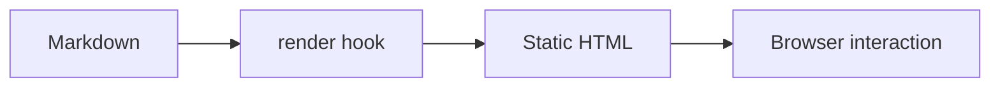

After writing for a while you notice that reading experience is shaped less by the words than by typography: whether code is highlighted, whether warnings get noticed, whether a long post can be skimmed. This sample article explains how the writing components in this theme are designed and used, and doubles as a template for new posts.

## Why render at build time

The most common misconception about static sites is that "static" means "no interaction". Interaction stays; only its execution point moves.

```tip {title="Core principle"}
Anything that can be decided at build time should not be computed in the browser.
```

In this theme, callouts, file trees, terminal output and diagram shells are emitted as HTML during the build. Only things that genuinely need a browser — mermaid rendering, code copy buttons, the image lightbox — keep a small runtime script.

```quote
Anything that can be solved at build time should not be left to runtime.
Design Principles | Project Handbook
```

The benefit is concrete: the first paint is complete HTML, search engines and RSS readers see exactly what a reader sees, and nothing breaks when a script fails to load. The trade-off is that editing content requires a rebuild, which is negligible for a personal blog.

## Writing workflow

Adding a post follows a fixed sequence:

```steps
Create the folder | A slug-named directory under content/posts
Write the body | index.md for the default language, index.en.md for a translation
Preview locally | hugo server with live reload
Publish | hugo --minify writes the static files
```

Previewing takes a single command:

```terminal
$ cd exampleSite
$ hugo server
Web Server is available at http://localhost:1313/
$ hugo --minify
```

```info
Local preview defaults to port 1313; pass -p to use another one if it is taken. Drafts are never included in the build output.
```

The content tree looks like this — indentation defines hierarchy:

```filetree
- content/
  - posts/ | Articles, one directory each
    - components-test/
      - index.md | Chinese original
      - index.en.md | English translation
      - bryce-canyon.jpg | Post image
  - about/ | About page
  - link/ | Links page
- data/
  - link.json | Links data
  - music.json | Player playlist
- exampleSite/ | Demo site
```

## Code and version diffs

Plain code blocks are highlighted by Chroma at build time; no client-side highlighter is loaded:

```js
// Highlighting happens during the build, not in the browser
const build = (source) => source.replace(/\s+$/, '')

export const slugify = (title) =>
  title
    .toLowerCase()
    .replace(/[^\w\u4e00-\u9fa5]+/g, '-')
    .replace(/^-|-$/g, '')
```

When the same idea appears in several stacks, use a code group:

```code-group
@tab hugo
hugo --minify --gc
@tab bash
hugo server --buildDrafts --navigateToChanged
@tab toml
theme = 'helloblog'
```

Configuration posts often need to show *what changed*. A diff block reads better than a screenshot and can be applied directly:

```diff
diff --git a/hugo.toml b/hugo.toml
index 8d3e5a7..4b1c9f2 100644
--- a/hugo.toml
+++ b/hugo.toml
@@ -8,6 +8,7 @@ defaultContentLanguage = 'zh'
 enableRobotsTXT = true
+disableKinds = ['term']
 
 [outputs]
   home = ['html', 'rss', 'json']
```

```warn
A diff block must follow git's unified diff format: keep the file headers, the @@ hunk header and the leading + - space characters, otherwise the copy cannot be applied.
```

## Structured content

Processes fit a flow block; arrows are drawn automatically:

```flow
Write Markdown | content/posts/*.md
Goldmark parses | Invoke the matching render hook
Emit HTML | Produce static files at build time
Browser interaction | A small amount of runtime script
```

For freer topology, switch to mermaid: the build only emits a container and the diagram renders on demand:



Content with a time axis belongs on a timeline, drawn in CSS rather than an image:

```timeline
2026-09 | Kickoff | Chose Hugo as the generator
2026-10 | Migration | Merged the writing components into the theme
2026-11 | Validation | Component regression and multilingual checks
```

For trade-off discussions, side-by-side columns beat a table:

```compare
@tab Build-time rendering
First screen is HTML
SEO-friendly
Content changes require a rebuild
@tab Runtime rendering
First screen depends on JS
SEO needs extra work
Content changes need no build
```

Common questions go into a Q&A block; answers stay collapsed so they do not interrupt the reading flow:

```qa
Do these components increase bundle size | No. They only emit HTML, with styles collected in pamin/post.css
Why not render with a frontend framework | Blog content rarely changes, so shipping a whole runtime for a bit of interaction is not worth it
```

Long asides can be collapsed:

```details
A collapsible supplement lives here
Markdown inside a details block is not rendered; the content is escaped as a whole and line breaks are preserved.
Useful for config snippets, full logs or secondary derivations.
```

## Typography details

Inline elements follow the same convention: keys are written as  + , versions as , emphasis uses ==highlight==, and everything else is standard Markdown — **bold**, _italic_, `inline code`.

Lists and quotes behave natively:

- Unordered lists for parallel items
- Ordered lists for steps with a fixed order
- Blockquotes only for quotations, outside any component pipeline

> Typography is not about looking good; it is about lowering the cost of understanding.

Tables work for comparisons:

| Component | Rendered at | Depends on |
| --- | --- | --- |
| Callouts / file tree / terminal | Build time | Nothing |
| Diagram shell | Build time | mermaid.js |
| Code highlighting | Build time | Chroma |
| Search | Runtime | minisearch |

Images use page resources, so width and height are filled in at build time to prevent layout shift:


```error
Keep the image next to index.md and reference it with a relative path; a missing file fails the build instead of being skipped silently.
```

Both external and internal links use plain Markdown; external ones automatically get `target="_blank"` and `rel="noopener noreferrer"`, for example [Hugo documentation](https://gohugo.io/documentation/) and [About this site](/en/about/).

## Wrapping up

The value of components is not their number but their consistency: one typographic language across the whole post, so readers never have to re-learn the structure. Every component above can be copied into a new article and reused by replacing the text.
